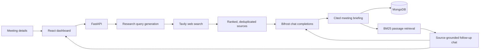

# Scriblyst - Meeting Intelligence Research Agent

### Walk into every meeting with the context to ask better questions.

Scriblyst turns recent, web-sourced information about a company into a concise meeting briefing—with developments, discussion angles, open questions, and citations. Ask follow-up questions in a source-grounded chat, and see which links informed the answer.

> **Built with:** React · FastAPI · Tavily · Bifrost · MongoDB

---

## The problem

Preparing for an important meeting often means piecing together company updates, news, and context across multiple tabs—then figuring out what is relevant to the conversation.

Scriblyst brings that preparation into one workflow: enter a company, meeting time, and optional objective; review a cited briefing; and use the underlying sources to explore follow-up questions.

## What it does?

- **Searches recent sources.** Builds research queries around the meeting subject and objective, then searches a 30-day window ending at the scheduled meeting time.
- **Creates a structured briefing.** Uses an OpenAI-compatible Bifrost model to produce an executive summary, recent developments, meeting insights, discussion questions, and caveats.
- **Keeps evidence visible.** Shows the sources behind developments and links back to the original pages.
- **Answers follow-up questions from the briefing.** Ranks source passages with BM25 keyword retrieval, sends the best matches to the model, and links the sources used. If nothing matches, it says so instead of sending unrelated sources.
- **Includes account and calendar flows.** Provides registration/login and Google Calendar connection and scheduling routes.

## How it works?



### Request flow

1. The dashboard submits the subject, meeting date/time, timezone, and optional objective.
2. The API generates research queries, searches the web, and deduplicates results by URL.
3. Up to eight of the highest-scoring sources are sent to the configured model for briefing analysis.
4. The report—including source metadata and content—is returned to the dashboard and saved.
5. For a follow-up question, BM25 ranks passages from that report's sources. The API sends up to four matching excerpts to the model and returns source links with the answer.

## Tech stack

| Area | Technology |
|---|---|
| Web app | React, Vite, React Router, Tailwind CSS |
| API | Python, FastAPI, Pydantic |
| Web research | Tavily Search API |
| LLM access | Bifrost OpenAI-compatible gateway |
| Persistence | MongoDB with PyMongo |
| Account security | Argon2 password hashing, JWT access tokens |
| Calendar integration | Google Calendar API and OAuth |

## Run locally

### Prerequisites

- Python 3.11 or newer
- Node.js and npm
- MongoDB (required for account registration and login)
- A Tavily API key
- A running Bifrost gateway with a configured model and API key

### 1. Configure the backend

From the repository root:

```powershell
cd backend
py -m venv .venv
.\.venv\Scripts\Activate.ps1
pip install -r requirements.txt
```

Create `backend/.env` and set the values below. Do not commit this file or put real credentials in screenshots or logs.

```dotenv
FRONTEND_ORIGIN=http://localhost:5173
FRONTEND_URL=http://localhost:5173

TAVILY_API_KEY=your-tavily-api-key
BIFROST_BASE_URL=http://localhost:8080/v1
BIFROST_API_KEY=your-bifrost-key
BIFROST_MODEL=groq/openai/gpt-oss-120b

MONGODB_URI=mongodb://localhost:27017
MONGODB_DATABASE=meeting_intelligence
JWT_SECRET_KEY=replace-with-a-long-random-secret
```

The model name and gateway URL are examples; use the values configured in your Bifrost deployment. Generate a local JWT secret with:

```powershell
py -c "import secrets; print(secrets.token_urlsafe(48))"
```

Start the API:

```powershell
uvicorn app.main:app --reload
```

The API runs at `http://localhost:8000`. Interactive API documentation is at `http://localhost:8000/docs`; the health endpoint is `http://localhost:8000/api/health`.

### 2. Configure and run the frontend

In another terminal, from the repository root:

```powershell
cd frontend
npm install
npm run dev
```

Open `http://localhost:5173`. To use a non-default API URL, set `VITE_API_BASE_URL` in `frontend/.env`, for example:

```dotenv
VITE_API_BASE_URL=http://localhost:8000
```

### Optional Google Calendar setup

To enable Google Calendar and Google Docs, configure `GOOGLE_CLIENT_ID`, `GOOGLE_CLIENT_SECRET`, `GOOGLE_REDIRECT_URI`, and `GOOGLE_TOKEN_ENCRYPTION_KEY` in `backend/.env`, and set up the matching OAuth redirect URI in Google Cloud. The default callback is `http://localhost:8000/api/calendar/callback`. Sign in to the app, open **Schedule meeting**, and choose **Connect Google Calendar** to grant Calendar and Docs access; the same stored OAuth connection is used when exporting a briefing to Google Docs.

## Try the workflow

1. Create an account and sign in.
2. Enter a company name, meeting date/time, timezone, and (optionally) the meeting objective.
3. Generate the briefing and review its developments, insights, questions, caveats, and cited sources.
4. Ask a follow-up question in the RAG research assistant. The response includes links to the sources retrieved for that question.
5. Optionally connect Google Calendar to schedule a meeting or export a briefing to Google Docs.

Google Docs exports format the briefing title and section headings, preserve bullet points, and make cited source IDs and source titles clickable links.

## API overview

| Endpoint | Purpose |
|---|---|
| `POST /api/research` | Search and generate a meeting briefing |
| `GET /api/research/{research_id}` | Retrieve a saved briefing |
| `GET /api/research/{research_id}/sources` | Retrieve a briefing's sources |
| `POST /api/research/{research_id}/chat` | Ask a question against that briefing's sources |
| `POST /api/research/{research_id}/export` | Export a briefing as a Google Doc |
| `POST /api/auth/register` | Register an account |
| `POST /api/auth/login` | Sign in |
| `GET /api/calendar/status` | Check Google Calendar connection |
| `POST /api/calendar/events` | Schedule a calendar event |
| `GET /api/health` | Check API availability |

See `/docs` for request and response schemas.

## RAG: what is implemented

The chat is **retrieval-augmented generation**, not model fine-tuning:

- It searches only the sources attached to the current briefing.
- It splits source text into overlapping passages and ranks them with BM25 keyword scoring.
- It sends up to four matching passages to the model, with source IDs, titles, and URLs.
- The model is instructed to answer only from those passages and cite source IDs.
- The UI displays links for the sources returned by retrieval.
- RAG assistant responses render Markdown formatting, including bold and italic text, headings, ordered and unordered lists, blockquotes, code, and tables.
- Markdown links in assistant responses open in a new tab; only HTTP and HTTPS links are clickable. Raw HTML in model output is not rendered.
- No matching passage means the API returns a “not found in these sources” response without calling the LLM.

This is a lightweight lexical retriever; it does not use embeddings, a vector database, or cross-briefing retrieval. Source reports are stored in MongoDB when configured; without `MONGODB_URI`, research reports use in-memory storage and disappear when the backend restarts. User accounts require MongoDB.

## Tests and production build

Run the backend tests:

```powershell
cd backend
.\.venv\Scripts\python.exe -m unittest discover -s tests -v
```

Build the frontend:

```powershell
cd frontend
npm run build
```

## Current limitations

- Research quality depends on search-provider coverage, available page content, and model output. Always verify important claims against the linked sources.
- Search results are requested for a 30-day window ending at the meeting time; provider-supplied publication dates may be missing or require independent verification.
- RAG retrieval is keyword-based and scoped to one report, so paraphrases may not retrieve the intended passage.
- Accounts require MongoDB. Without MongoDB, only research-report storage falls back to process memory.
- Google Calendar scheduling and Google Docs export require a connected Google account with the Calendar and Docs OAuth scopes enabled.
- `/api/meetings` is a provider integration placeholder; it does not currently fetch meetings from Meet, Zoom, or Teams.

## Security notes

- Keep API keys, OAuth client secrets, database credentials, and JWT secrets in environment files or a secrets manager—never in source control.
- Use a unique, strong `JWT_SECRET_KEY` outside local development.
- Restrict CORS origins and configure HTTPS before deployment.
- Configure and verify OAuth scopes and redirect URIs for the intended deployment.
